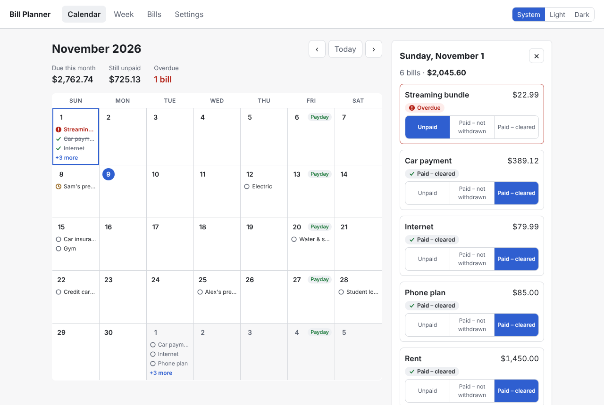
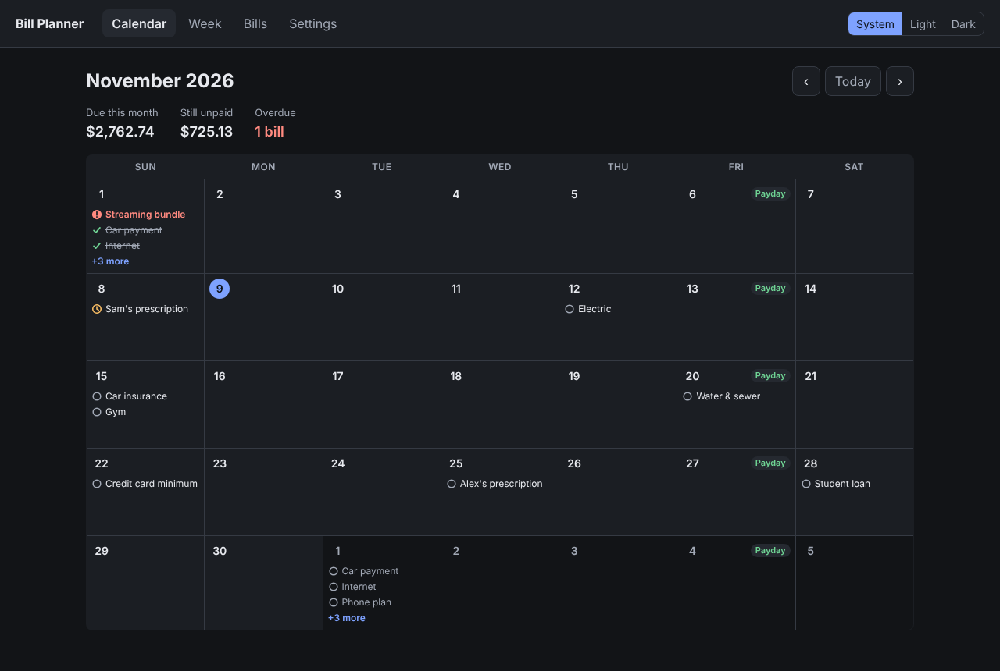
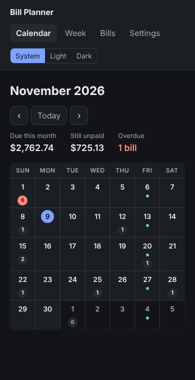

# Household Bill Planner

[](https://github.com/TiaMarieG/household-bill-planner/actions/workflows/ci.yml)

A shared bill planner for a two-income household. It tracks recurring bills (including
ones that don't fit a monthly cycle), estimates take-home pay from hours worked, and
answers the question that matters on payday: **after this week's bills, what's left?**

> **Status: work in progress, local-only.** There is no login yet, so the app is not
> meant to be deployed as-is. The repository contains **no real financial data**; the
> screenshots use generated sample data.



<p>
  
  
</p>

## Features

**Built**

- **Recurring bills on any cycle:** monthly (a bill due on the 31st lands on Feb 28,
  then back on Mar 31), every N days (a 28- or 30-day prescription), every N weeks,
  quarterly, and one-time.
- **Three payment states per due date:** Unpaid, *Paid – not withdrawn* (payment sent,
  money still in the account), and Paid – cleared.
- **Month calendar:** paydays, overdue flags, the most urgent bills first on busy days,
  a "+N more" panel listing everything due that day, and a phone layout.
- **Dark mode:** follows the system setting or a saved choice, with no flash on load.
- **Pay estimates:** hourly (with overtime calculated per workweek) or salary, a flat
  withholding rate calibrated from a paystub, weekly or bi-weekly schedules, and the lag
  between the end of a pay period and payday.
- **Payday-to-payday summary (API):** starting balance + expected pay − bills = what's
  left, projected week by week, with balance history.
- **Shared data:** one database for both people, so neither view goes stale.

**Planned**

- Week view, bill management and settings screens (the API for these already exists)
- Alerts for unpaid bills due within 3 days and payments not yet withdrawn
- Detailed debt tracking
- Login and deployment, with a public demo using sample data
- AI features: natural-language bill entry and a debt payoff advisor (the math stays in
  tested code; the model explains it)

## Engineering highlights

- **Money is exact.** `Decimal` in Python and `NUMERIC(12,2)` in Postgres; the frontend
  adds display totals in whole cents (in JavaScript, `0.1 + 0.2` is
  `0.30000000000000004`).
- **Overtime is per workweek, as US wage law requires.** 45 + 35 hours in a bi-weekly
  period pays 5 overtime hours even though the total is exactly 80.
- **Schedules never drift.** Every due date is calculated from the bill's first due
  date, not from the previous one, so month-end clamping doesn't stick.
- **Payment statuses are stored only for due dates that change.** Everything else is
  generated from the schedule, so editing a bill's schedule doesn't strand old data.
- **Date bugs designed out:** `new Date("2026-11-06")` is UTC midnight, which is Nov 5
  in Pacific time (every bill would show a day early). The calendar uses whole-day
  arithmetic, so the daylight-saving change on Nov 1 can't skip or repeat a day.
- **The database is the last line of defense.** CHECK constraints reject invalid data
  even if the API is bypassed, including a NULL edge case that a test caught (`NULL > 0`
  is NULL, which Postgres treats as passing).
- **Simultaneous edits are safe:** status writes use `INSERT ... ON CONFLICT`, so two
  people marking the same bill at once can't cause an error.
- **Accessible by default:** WCAG AA contrast in both themes, status shown by icon shape
  and text rather than color alone, and keyboard and screen-reader support throughout.

## Testing

250+ automated tests run in CI on every push.

- **Backend (pytest):** runs against a real Postgres, not an in-memory substitute. Each
  run rebuilds the schema by migrating down and back up, which tests the migrations in
  both directions, and every test is rolled back afterwards. In CI, a missing test
  database fails the build rather than quietly skipping 100+ tests.
- **Frontend (Vitest + Testing Library):** components are queried by role and accessible
  name, the way a screen-reader user finds them. Date logic is tested in time zones from
  UTC−11 to UTC+14.
- **CI also checks** that the migrations match the models (`alembic check`) and that the
  production build succeeds.

## Tech stack

| Layer    | Tech                                                 |
| -------- | ---------------------------------------------------- |
| Backend  | Python 3.11+, FastAPI, SQLAlchemy 2, Pydantic        |
| Database | PostgreSQL 17 (Docker), Alembic migrations           |
| Frontend | React 19, Vite, React Router, TanStack Query         |
| Tests    | pytest, Vitest, Testing Library, GitHub Actions      |

```
backend/app/
  domain/     pure business logic: recurrence, pay, budget math (no database)
  services/   business rules that use the database
  routers/    thin HTTP layer
frontend/src/
  lib/        date, money and calendar helpers
  pages/      one component per screen
scripts/      cross-platform setup, dev, test and seed runners
```

## Running locally

**Prerequisites:** [Docker Desktop](https://www.docker.com/products/docker-desktop/) (running),
Python 3.11+, Node.js 20+. Works in Git Bash, PowerShell and macOS/Linux terminals.

```bash
npm run setup      # once, and again after pulling changes that add packages or migrations
npm run seed       # optional: fill the database with fake sample data
npm run dev        # every time: database + API + web app, with live reload
```

- App: http://localhost:5173
- API docs: http://localhost:8000/docs

Press `Ctrl+C` to stop the API and web app. The database keeps running in the
background; stop it with `npm run db:stop`.

### Commands

| Command           | What it does                                                                 |
| ----------------- | ---------------------------------------------------------------------------- |
| `npm run setup`   | Creates `.env` (random local DB password) if missing, creates `backend/.venv`, installs Python and npm packages (root and frontend), starts Postgres, creates the test database, applies migrations. Safe to rerun. |
| `npm run dev`     | Starts Postgres, applies any new migrations, then runs the API and web app together. |
| `npm test`        | Runs backend (pytest) and frontend (Vitest) tests and reports both.          |
| `npm run seed`    | Fills an empty local database with fake sample data (dates relative to today). Add `-- --reset` to replace existing data. Refuses to run when `APP_ENV=production`. |
| `npm run db:stop` | Stops the Postgres container. Data is kept.                                  |

There is one `.env` in the repo root, read by both Docker Compose and the backend.
You never need to activate the virtual environment; the scripts call its Python directly.

### Resetting the database

```bash
docker compose down -v    # deletes all local data
npm run setup
```

The container creates `bill_planner` for the app; `npm run setup` and `npm run dev`
create `bill_planner_test` for tests if it is missing. If Postgres won't start,
`docker compose logs db` shows why.

### Running one test suite

Database tests run against `TEST_DATABASE_URL`. Locally, if the database isn't running,
they are skipped and the reason is printed.

```bash
cd backend && .venv/Scripts/python -m pytest     # macOS/Linux: .venv/bin/python
cd frontend && npm test
```

### Schema changes

Run from `backend/` with the virtual environment's Python
(`.venv/Scripts/python` on Windows, `.venv/bin/python` on macOS/Linux):

```bash
python -m alembic revision --autogenerate -m "describe the change"   # review the generated file
python -m alembic upgrade head
python -m alembic check                                              # models and migrations agree
```

## About this project

Built with AI pair-programming; I reviewed, tested, implemented fixes, and applied every change myself.

## License

[MIT](LICENSE) © 2026 Tia Marie Gordon
